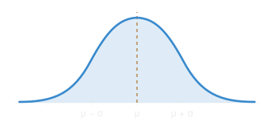
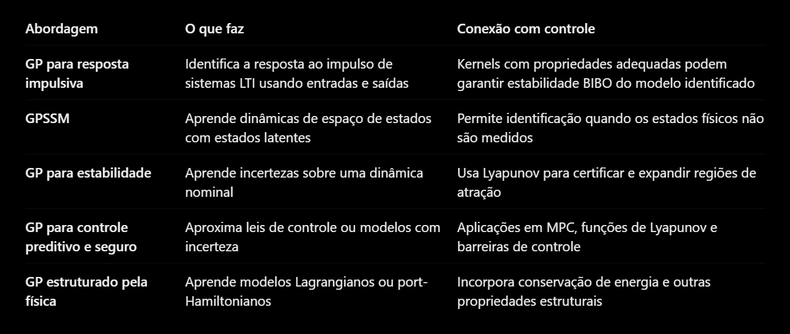

# Gaussian Processes

Um processo gaussiano é, em linhas gerais, uma maneira de modelar uma função desconhecida por meio de um processo estocástico.

## Alguns fundamentos

Dada uma variável aleatória $X$, dizemos que

$$
X\sim\mathcal N(\mu,\sigma^2)
$$

segue uma distribuição normal, dada por

O princípio, em linhas gerais, de um processo gaussiano é tratar os valores de saída de uma função como um conjunto de variáveis aleatórias, permitindo que elas se correlacionem por meio da covariância.

Portanto, dado um vetor de variáveis aleatórias $X_1,\ldots,X_n$, em que cada uma tem uma distribuição normal, é preciso definir como duas variáveis aleatórias variam conjuntamente em relação às respectivas médias. Ou seja, precisamos conhecer também como essas variáveis se relacionam estatisticamente. Isso é dado por meio da covariância:

$$
\operatorname{Cov}(X_i,X_j)
=
\mathbb E[(X_i-\mu_i)(X_j-\mu_j)]
$$

A covariância mede a tendência de duas variáveis desviarem de suas respectivas médias na mesma direção ou em direções opostas.

A matriz de covariância pode ser definida, assim, por

$$
\Sigma=
\begin{bmatrix}
\sigma_1^2 & \sigma_{12} & \sigma_{13}\\
\sigma_{12} & \sigma_2^2 & \sigma_{23}\\
\sigma_{13} & \sigma_{23} & \sigma_3^2
\end{bmatrix}
$$

Ela precisa ser simétrica e semidefinida positiva. Para termos uma distribuição normal multivariada, é preciso que as variáveis sejam **conjuntamente gaussianas** (o que não decorre apenas de cada uma ser gaussiana individualmente):

$$
\mathbf X\sim\mathcal N(\boldsymbol\mu,\Sigma)
$$

Além disso, é preciso entender o **condicionamento e a inferência bayesiana**, que implicam que a observação de certos valores permite atualizar nossa distribuição de probabilidade sobre uma quantidade desconhecida. Matematicamente,

$$
p(\theta\mid D)
=
\frac{p(D\mid\theta)p(\theta)}{p(D)}
$$

- $p(\theta)$: distribuição a priori, antes dos dados.
- $p(D\mid\theta)$: verossimilhança dos dados.
- $p(\theta\mid D)$: distribuição a posteriori, depois de incorporar os dados.

Quando trabalhamos com variáveis conjuntamente gaussianas, suas distribuições condicionais também são gaussianas.

Assim, chegamos à ideia central: tratar os valores de uma função em diferentes pontos como variáveis aleatórias conjuntamente gaussianas.

## Definição central

$$
f\sim\mathcal{GP}\big(m(x),k(x,x')\big)
$$

- $f$: função aleatória; uma realização do processo corresponde a uma função candidata.
- $f(x)$: variável aleatória que representa o valor da função na entrada $x$.
- $\sim$: é distribuída segundo.
- $\mathcal{GP}$: processo gaussiano.
- $m(x)$: média de $f(x)$.
- $k(x,x')$: função de covariância (*kernel*), que estabelece como os **valores da função** em duas entradas se correlacionam.

No processo gaussiano, podemos escolher arbitrariamente qualquer conjunto finito de entradas $x_1,\ldots,x_n$ e construir:

$$
\begin{bmatrix}
f(x_1)\\
f(x_2)\\
\vdots\\
f(x_n)
\end{bmatrix}
\sim
\mathcal N
\left(
\begin{bmatrix}
m(x_1)\\
m(x_2)\\
\vdots\\
m(x_n)
\end{bmatrix},
\begin{bmatrix}
k(x_1,x_1)&\cdots&k(x_1,x_n)\\
\vdots&\ddots&\vdots\\
k(x_n,x_1)&\cdots&k(x_n,x_n)
\end{bmatrix}
\right)
$$

Portanto, um GP é definido por uma família consistente de distribuições gaussianas para os valores da função.

A parte mais importante de um GP é a escolha do *kernel*, pois ele incorpora hipóteses sobre o comportamento das funções que consideramos plausíveis. Na definição, ele determina como os valores $f(x_1),\ldots,f(x_n)$ se correlacionam, a partir das entradas $x_1,\ldots,x_n$.

Ele também precisa produzir matrizes de covariância semidefinidas positivas para qualquer conjunto finito de entradas.

Em linhas gerais, o artigo diz que:

